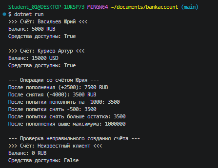

# Банковский аккаунт

* **Автор: Куриев Артур**
* **Группа: ИСП-241**
* **Дата выполнения: 19.11.2026**

---

#### Структура

В своём проекте я создал два файла:
1. `BankAccount.cs` - основной файл, имеющий все методы, поля и конструктор
2. `Program.cs` - файл для запуска программы и проверки работоспособности

В `BankAccount.cs` я реализовал конструктор `BankAccount`, в котором установил обязательными параметрами: `owner` и `initialBalance`, где это соответственно имя владельца и начальный баланс. Параметр `currency` - является необязательным и если его не вводить при вызове - ничего не сломается, так как по умолчанию там и так выбрана валюты `RUB`. Также в конструкторе идёт проверка, чтобы начальный баланс не был ниже нуле или выше максимального значения, равного 1000000. И для валюты есть проверка, чтобы значение не было введено пустое или только с пробелами - в таком случае валюта будет `RUB`, в ином - это будет введенная валюта в заглавном регистре.

---

#### Методы

* `Deposit` - пополнение баланса на введенное значение. Проверяется чтобы оно не было неположительным, и чтобы при пополнение баланс не становился больше, чем максимальное значение `MaxBalance`. Если проходит все проверки - баланс увеличивается на введенное значение `amount`, а если же увеличивается баланс на сумму, равную больше `MaxBalance` - тогда нынешняя сумма будет равна как раз `MaxBalance`.

* `Withdraw` - снятие введенной суммы с баланса. Проверяется, чтобы значение было меньше или равно значение нынешнего `Balance` и чтобы само `amount` было положительным. Если проходит эти проверки - тогда с баланса отнимается введенная сумма.

* `HasFunds` - проверка на то, есть ли на балансе любая сумма, то есть доступны ли на счету средства. Возвращает `true` или `false`.

* `GetInfo` - вывод информации о банковском аккаунте. Возвращает имя владельца, баланс с выбранной валютой и доступны ли на аккаунте средства.

---

#### Поля и свойства

В классе `BankAccount` есть 2 поля и 3 свойства. Поле `MaxBalance` - константа, которая не меняется, она равна 1.000.000 (одному миллиону). Поле `_owner` - по умолчанию назначаем ему имя "Неизвестный клиент". Свойство `Owner` - тут мы делаем проверку на то, чтобы имя нашего клиента не было пустым, либо не состояло исключительно из пробелов. Если что-то из этого оказывается правдой - мы оставляем нашего клиенту имя "Неизвестный клиент". В ином случае мы на всякий случай для нашего имени используем `Trim()`, чтобы удалить лишние пробелы по бокам. Свойство `Balance` - текущий баланс нашего клиента. Свойство `Currency` - выбранная денежная валюта.

#### Скриншот запуска программы 

